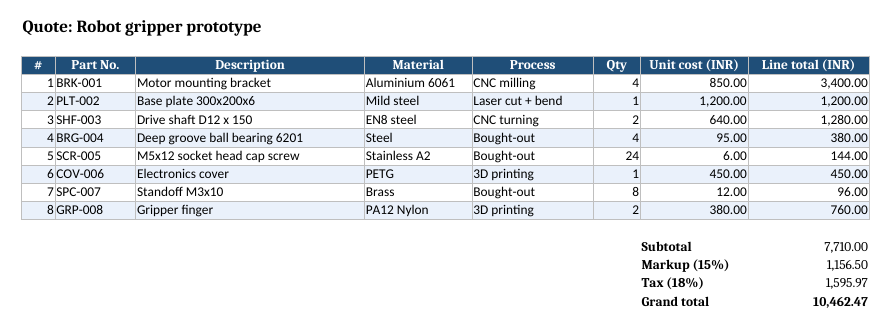
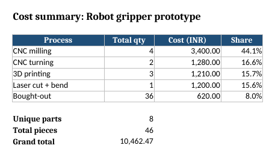

# BOM to Excel quote sheet

I wrote this small Python script to turn a parts list (BOM) exported as CSV into an Excel quote sheet I could actually send to someone.

You give it a CSV. It gives back an .xlsx file with two tabs:

- **Quote**: every part with part number, description, material, process, quantity, unit cost and line total. Below the table it adds subtotal, markup, tax and grand total. These are real Excel formulas, so if you change a quantity or price in Excel the totals update.
- **Summary**: cost and quantity grouped by manufacturing process (CNC milling, 3D printing, bought-out and so on), each process's share of the cost, the number of unique parts, total pieces and the grand total.




## Running it

You need Python 3 and openpyxl (`pip install openpyxl`).

```
python3 bom_to_excel.py sample/bom_sample.csv -o output/quote_sample.xlsx --project "Robot gripper prototype"
```

Options:

| Option | Default | What it does |
|---|---|---|
| `-o, --output` | `quote.xlsx` | Output file |
| `--project` | `BOM quote` | Title shown at the top of each tab |
| `--currency` | `INR` | Currency label in the column headers |
| `--markup` | `0.15` | Markup as a fraction (0.15 = 15%) |
| `--tax` | `0.18` | Tax applied on subtotal plus markup (0.18 = 18%) |

## CSV format

Required columns: `part_number`, `description`, `qty`, `unit_cost`.
Optional: `material`, `process`. Column names are not case sensitive.

If a row has a quantity or cost that isn't a number, the script skips that row and prints a warning with the line number. If a required column is missing, it stops and tells you which one.

## Sample

`sample/bom_sample.csv` is a made-up BOM for a small gripper prototype (8 parts). The prices in it are placeholders I typed in, not real supplier quotes. The output is in `output/quote_sample.xlsx`.

## What it doesn't do yet

It doesn't read directly from SolidWorks or Fusion 360, and it doesn't look up prices. You export the BOM to CSV and fill in the costs yourself. Reading BOM exports straight from CAD tools is what I'd like to add next.
